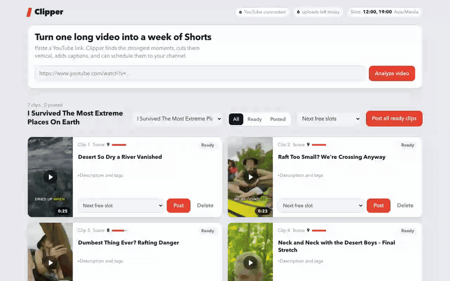

# Clipper

YouTube URL → ranked, captioned 9:16 clips → (after you approve) scheduled private uploads to your channel. Runs locally on Apple Silicon.

## Demo



[Watch the full demo (MP4, 23s)](docs/demo.mp4)

## Setup
```bash
brew install yt-dlp ffmpeg            # already done on this Mac
python3 -m venv .venv && .venv/bin/pip install mlx-whisper opencv-python-headless pillow numpy \
  fastapi uvicorn python-multipart google-api-python-client google-auth-oauthlib requests python-dotenv pytest tzdata
cp .env.example .env                  # then fill in the values
```
`.env`: `LLM_PROVIDER` (`anthropic` or `openai` = any OpenAI-compatible API), `LLM_API_KEY`, `LLM_BASE_URL`, `LLM_MODEL`.
Face model: `models/face_detection_yunet_2023mar.onnx` (OpenCV zoo, bundled). Whisper model (`whisper-large-v3-turbo`, ~1.6 GB) downloads on first run.

## Usage
```bash
.venv/bin/python clip.py "<youtube-url>" --count 5   # download → transcribe → pick → render
.venv/bin/python clip.py serve                       # web app at http://127.0.0.1:8790
.venv/bin/python clip.py approve <video_id> all      # or: approve <video_id> 1 3
.venv/bin/python clip.py auth                        # one-time Google login
.venv/bin/python clip.py publish                     # upload approved clips (private + publishAt)
```
Output: `output/<video-id>/clip_NN.mp4` + `clips.json` (status: pending → approved → scheduled → uploaded, or failed). Transcripts are cached in `cache/<id>/`, so reruns skip download and Whisper. From the CLI, nothing uploads unless a clip is `approved`. In the web UI, pressing **Post** on a clip (or **Post all**) is the approval. The only way to skip review is the opt-in "Upload every clip automatically" switch, which asks for confirmation each time and is off by default.

Schedule: `schedule.json` (optional), default `{"timezone":"Asia/Manila","times":["12:00","19:00"]}`. Each clip gets the next free slot.

## YouTube setup (one time)
1. https://console.cloud.google.com → project picker → **New Project** (e.g. "clipper").
2. **APIs & Services → Library** → search **YouTube Data API v3** → **Enable**.
3. **APIs & Services → OAuth consent screen** (Google Auth Platform) → User type **External** → app name, your email → Save.
4. **Audience / Test users → Add users** → add your own Google account.
5. **Credentials → Create credentials → OAuth client ID → Desktop app** → download the JSON, save as `client_secret.json` in this folder (gitignored).
6. Run `python clip.py auth`, pick the channel's account, accept the "unverified app" warning (Advanced → continue). `token.json` is stored locally (gitignored, mode 600).

Note: while the consent screen is in **Testing**, refresh tokens expire after 7 days — re-run `auth` when `publish` says the token is invalid.

## Daily scheduler
Template: `launchd/com.ervenderr.clipper.publish.plist` (runs `publish` daily 09:00). Not installed automatically (it lives outside this folder). **Do the single-clip test upload first**, then:
```bash
cp launchd/com.ervenderr.clipper.publish.plist ~/Library/LaunchAgents/
launchctl load ~/Library/LaunchAgents/com.ervenderr.clipper.publish.plist
```
**The Mac must be awake** (or wake later: launchd runs a missed job on wake, but not while powered off). Uploads are scheduled on YouTube's side via `publishAt`, so only the *upload* needs the Mac, not the publishing.

## Quota
Tracked in `quota.json` (resets midnight Pacific). Docs conflict on the videos.insert cost (the quota-cost page says both "1600" and "1 unit in a 100/day upload bucket"), so the code assumes the conservative **1600 of 10,000/day = 6 uploads/day**. Override with `YT_UPLOAD_COST` / `YT_DAILY_QUOTA` env vars once you confirm the real numbers in Cloud Console → IAM & Admin → Quotas. Clips beyond the budget stay `approved` and go out next run.

## Unverified project (private lock) and audit
YouTube has historically forced videos uploaded by *unverified* API projects to **private** and ignored scheduling; the current docs page for `videos.insert` says the opposite, so this is unconfirmed. After upload the tool re-reads the video and warns if `privacyStatus`/`publishAt` didn't stick, but it can't detect a Studio-side lock. **Check the first upload in YouTube Studio.** If it's locked, the fix is Google's compliance audit, not a workaround: submit the *YouTube API Services Audit and Quota Extension Form* (linked from the YouTube API "Quota and Compliance Audits" guide); a YouTube API team member contacts you and reviews ToS compliance. Until then, publish manually from Studio.

## AI-altered content
`status.containsSyntheticMedia` is sent only when a clip's "realistic altered/synthetic content" box is ticked (default off; plain cuts, crops and captions don't qualify).

## Known limits
- Reframing is a face-centered crop of the 16:9 source (largest face wins); multi-speaker or screen-share videos look rough; falls back to center crop when no face is found.
- Captions are per-word highlighted, up to 3 words at a time, Arial Bold, fixed position (this ffmpeg lacks libass, so they're drawn with Pillow).
- Highlight quality depends on the LLM; the reasoning model is slow (~2 min per call on the test video). Long videos are chunked (~14k chars/call); each chunk costs one call.
- Retried uploads are resumable; a crash mid-upload leaves `upload_started` set and the clip is skipped on later runs (never duplicates) — verify in Studio, then clear that field to retry.
- Default category is People & Blogs (`YT_CATEGORY_ID` in `clipper/config.py`). Output is 1080x1920 H.264 at 30fps.
- Tests: `.venv/bin/python -m pytest tests`.

## Measured timings (M5 Air, 3:27 video, 3 clips)
download 4s · Whisper 68s (incl. 25s first-time model download) · LLM selection 136s · render ~11s per 30-50s clip.

## Web app
Paste a link → **Analyze** (shows title, length, suggested clip count: about 1 per 2.5 min, max 20) → set the count → **Make clips**. A live pipeline view shows each stage and drops clip markers onto the source timeline as they are found. Each clip card lets you edit title/description and **Post** it: next free slot, a time you pick, or private with no schedule. **Post all clips** does the same for a whole batch. The header shows YouTube login state, uploads left today, and your slots. Posting needs `token.json` (run `clip.py auth` once). Uploads never run in parallel, and a clip that was already uploaded or is mid-upload is refused.
